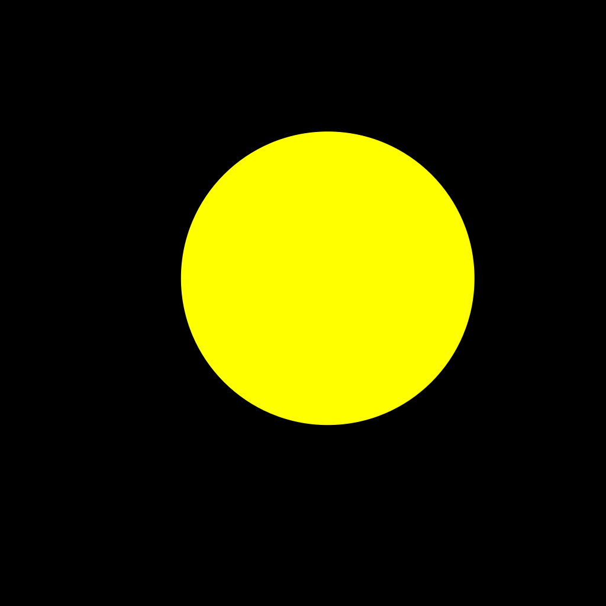

# Avatar concept

These social media avatar prototypes explore how to express an Agent’s intention.
Yellow (#FFFF00) is the selected color.

## a-dot-shift

A single yellow dot sits slightly above and right of center on black.
The image retains the original single-dot prototype: center
(553.7612260356422, 470.2387739643578), radius 248, on a 1024 × 1024 canvas.

## a-crowd-ball

Equal-size yellow dots gather densely in the highlight and spread out toward
the shadow. Organic arrangement is the selected direction.

[Crowd comparison](a-crowd-ball/crowd-comparison.png) preserves the reference
and six arrangement studies. The comparison records the exploration;
[avatar.png](a-crowd-ball/avatar.png) is the supplied image currently in use,
preserved without regeneration or separate square/circular copies.

Open [generator.html](a-crowd-ball/generator.html) directly in a browser to
adjust the dot field and export PNG or SVG. It preserves the Page’s generation
algorithm and controls, adds standalone styling, and opens with the saved Page
settings. Those settings are an editable starting point; the supplied current
avatar is the authoritative image, not a claim of pixel-identical regeneration.
